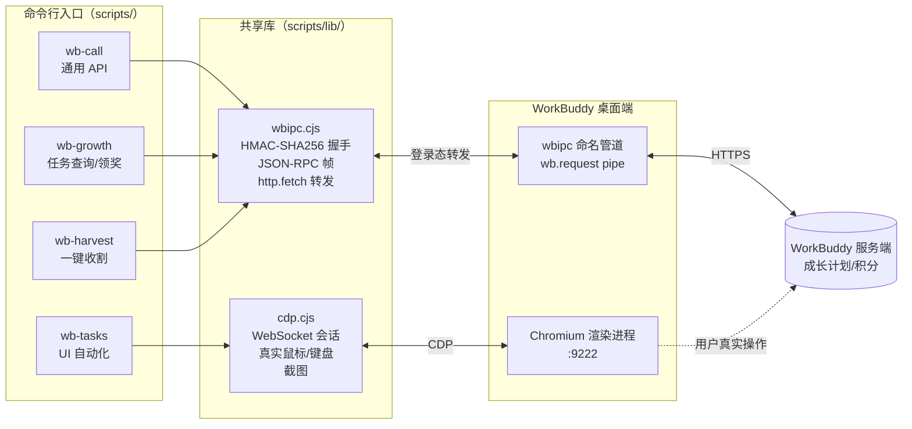

<div align="center">


# 🚀 wb-growth-auto

**WorkBuddy 成长计划自动完成器**

查询 · 接取 · 领奖 · 签到 · 派猫 · 抽奖 —— 一条命令全收割
专家召唤 · 模板使用 · 定时任务 · 待确认处理 —— CDP 驱动真实 UI 自动完成

[](LICENSE)
[](https://nodejs.org/)
[](#)
[](#)
[](CHANGELOG.md)

[功能](#-功能一览) · [快速开始](#-快速开始) · [架构](#-架构) · [命令参考](#-命令参考) · [安全](#-安全设计) · [迭代](#-版本与迭代)

</div>

---

## 这是什么

WorkBuddy 的「成长计划」有 18+ 个任务：签到、召唤专家、用模板、设自动化……手动点一遍要半小时，还天天有。
**wb-growth-auto 把这套流程工程化**：一条命令完成所有可自动化的动作，实测一遍收割 **+1500 积分**。

它不是脚本小子式的接口伪造——所有动作要么是客户端登录态下的**官方 API 调用**，要么是 CDP 驱动的**真实 UI 点击**，等价于你坐在电脑前亲手操作，进度由服务端校验。

> ⚡ 实测战绩：18 个成长任务自动完成 15 个，3 个剩余任务均需真人扫码/账号授权，物理不可自动。

## ✨ 功能一览

| 能力 | 入口 | 路线 | 幂等 |
|---|---|---|---|
| 任意官方 API 调用（借客户端登录态） | `wb-call.cjs` | wbipc | - |
| 成长任务：查状态 / 接取 / 领奖 | `wb-growth.cjs` | wbipc | ✅ |
| 一键收割：签到+旅行+任务+连登+抽奖 | `wb-harvest.cjs` | wbipc | ✅ |
| 召唤专家 / 专家团并完成对话 | `wb-tasks.cjs experts/teams` | CDP | ✅ |
| 五类模板一键使用 | `wb-tasks.cjs templates` | CDP | ✅ |
| 发现应用面板真实打开 | `wb-tasks.cjs app` | CDP | ✅ |
| 「待确认」会话排查与答复 | `wb-tasks.cjs pending/tc/visit` | CDP | ✅ |
| 窗口截图 / 任意 JS 注入（调试） | `wb-tasks.cjs shot/eval` | CDP | - |

**wbipc** = WorkBuddy 本地 RPC 桥（命名管道 + HMAC-SHA256 握手），脚本以客户端登录态转发请求，**零凭据接触**。
**CDP** = Chrome DevTools Protocol，驱动客户端真实界面，专治「必须用过才算数」的体验类任务。

## 🎬 演示

```console
$ node scripts/wb-harvest.cjs
[11:42:58] 已连接 wbipc，可见 pipe: wb.entitlement, wb.request, wb.wecom-a2a
[11:42:58] 【签到】活动: Buddy应用；今日已领: true；连续: 2 天
[11:42:58] 【签到】今日已签到，跳过
[11:42:59] 【旅行】猫在路上 (健身房)，到家后再跑一次领奖
[11:42:59] 【任务】已接取 5 个任务: 完成一次对话、完成技能安装、链接微信、召唤一次专家、使用一次模板
[11:42:59] 【任务】共 5 个任务 (available=5)，无待领奖励
[11:43:00] 【连登】已连登 1 天；下档 7d 还差 6 天
[11:43:00] 【抽奖】抽奖次数 0，跳过
[11:43:00] ==== 收割完成，共 7 条结果 ====

$ node scripts/wb-tasks.cjs experts "抖音策略师"
== 抖音策略师
   {"ok":true,"step":["点卡片:抖音策略师","召唤","发送"]}
   对话完成: true
```

以上为真实运行输出（已签到/旅行中/无可领奖励时的幂等表现）。成长任务进度由服务端校验，**延迟 1~5 分钟**——发完稍等，`claim-all` 收尾领奖。

## 🚀 快速开始

### 前置条件

| 条件 | 说明 |
|---|---|
| WorkBuddy 桌面端已启动并登录 | 端点文件 `~/.workbuddy/wbipc/endpoint.json` 存在即可用 API 路线 |
| Node.js ≥ 18 | **零依赖**，clone 即用，无需 `npm install` |
| CDP 调试端口（仅 UI 路线） | 客户端以 `--remote-debugging-port=9222` 启动 |

开启 CDP（Windows PowerShell）：

```powershell
& "$env:LOCALAPPDATA\Programs\WorkBuddy\WorkBuddy.exe" --remote-debugging-port=9222
```

### 三条命令上手

```bash
node scripts/wb-growth.cjs status       # 1. 摸底：哪些任务没完成
node scripts/wb-harvest.cjs             # 2. 收割：签到/旅行/接任务/领奖/抽奖
node scripts/wb-growth.cjs claim-all    # 3. 收尾：领取全部已完成奖励
```

体验类任务（需 CDP）：

```bash
node scripts/wb-tasks.cjs experts "中国电商运营专家" "抖音策略师"
node scripts/wb-tasks.cjs teams "内容创作专家团" "花叔数据分析专家团"
node scripts/wb-tasks.cjs templates     # 模板 5 连
```

> **Git Bash 用户注意**：直接调 `wb-call.cjs GET /v2/...` 时路径会被 MSYS 转换，
> 必须加 `MSYS_NO_PATHCONV=1`（`wb-growth.cjs` / `wb-harvest.cjs` 进程内调用，不受影响）。

## 🏗 架构



设计要点：

- **两条路线各治一类任务**：API 路线治「领奖/签到」类（服务端判定）；CDP 路线治「体验」类（客户端埋点 + 服务端校验）。
- **写操作白名单**：仅 `tasks/accept`、`tasks/{code}/claim`、签到/旅行/抽奖领取，其余写接口一律不调。
- **不伪造任何事件**：进度全部由服务端按真实行为校验，脚本被检测到也没有任何「伪造」可检测——因为它真的在操作。

## 📖 命令参考

### wb-growth.cjs — 任务速查/领奖

```bash
node scripts/wb-growth.cjs status [--json]   # 任务列表：code/状态/进度/标题
node scripts/wb-growth.cjs accept-all        # 接取所有 available 任务
node scripts/wb-growth.cjs claim <code>      # 领单个
node scripts/wb-growth.cjs claim-all         # 领全部 completed
```

### wb-harvest.cjs — 一键收割（幂等，适合挂定时）

```bash
node scripts/wb-harvest.cjs                  # 全量收割
node scripts/wb-harvest.cjs --report         # 只查不动
node scripts/wb-harvest.cjs --no-lottery --no-travel
node scripts/wb-harvest.cjs --dump           # 调试：打印原始响应
node scripts/wb-harvest.cjs --tasks-out=t.json
```

### wb-tasks.cjs — UI 自动化（需 CDP 端口）

| 命令 | 作用 |
|---|---|
| `experts "名1" ...` | 搜索→点卡片→召唤→发送预填话术→等对话结束，模糊匹配 |
| `teams "团1" ...` | 同上，先切「专家团」页签 |
| `templates` | 金融/数据/PPT/研究/策划 五分类各发一条 |
| `app` | 真实点击打开「发现应用」 |
| `pending` | 列出所有「待确认」会话 |
| `tc "<会话名>"` | 真实鼠标事件切换会话 |
| `visit "<会话名>" [out.png]` | 切会话+截图+抓按钮（单连接闭环，防焦点弹回） |
| `shot <path>` / `eval "<js>"` / `targets` | 调试三件套 |

### 配置项（环境变量）

| 变量 | 默认 | 说明 |
|---|---|---|
| `WORKBUDDY_CONFIG_DIR` | `~/.workbuddy` | wbipc 端点文件目录 |
| `WB_CDP_PORT` | `9222` | CDP 调试端口 |
| `WB_SHOT_DIR` | `./shots` | 截图输出目录 |

## 🔒 安全设计

- **零凭据接触**：wbipc 握手用本地 `endpoint.json` 的一次性 ticket 做 HMAC-SHA256 双向校验，脚本从不读写 token，不落盘任何凭据。
- **写操作白名单**：只调领奖/接任务/签到/旅行/抽奖接口 + CDP 页面内真实点击，其余写接口一律拒绝。
- **扫码/登录不代做**：关注公众号、连接器授权等账号级动作，脚本明确跳过并报告。
- **透明可审计**：`--report` 只读模式 + `--dump` 全量响应输出，每一步干了什么都有日志。
- **诚实提醒**：专家对话消耗积分（实测每个 5~15 分），收益（50~100/任务）远大于成本，但批量跑前请看一眼。

## ⚠️ 已知限制

- 任务进度服务端校验有 **1~5 分钟延迟**，发送后立刻查 status 会误判失败——等一会再查。
- 「体验发现应用」需真实启动一个应用才计数（仅打开面板不计数，实测）。
- 「腾讯轻量云专家」等需连接器授权、「关注公众号」需微信扫码+24 小时——物理不可自动。
- UI 路线依赖客户端 DOM 选择器，客户端大改版后需更新（见 [docs/pitfalls.md](docs/pitfalls.md) 的选择器清单与重新探测方法）。

## 🛠 版本与迭代

- 遵循 [SemVer](https://semver.org/lang/zh-CN/)，变更记录见 [CHANGELOG.md](CHANGELOG.md)。
- 客户端改版导致选择器失效：`wb-tasks.cjs eval` 探测新 DOM → 更新选择器 → 升 minor。
- 接口变更：`wb-harvest.cjs --dump` 抓原始响应 → 更新字段映射 → 升 patch/minor。
- 更多接口细节：[docs/api.md](docs/api.md)；踩坑实录：[docs/pitfalls.md](docs/pitfalls.md)。

## 📦 作为 WorkBuddy 技能安装

```bash
# Windows
xcopy /E /I . "%USERPROFILE%\.workbuddy\skills\wb-growth-auto"
# macOS / Linux
cp -r . ~/.workbuddy/skills/wb-growth-auto
```

之后对 WorkBuddy 说一句「跑一下成长计划收割」即可触发。

## 🤝 贡献

Issue 和 PR 欢迎。改 UI 自动化前请先读 [docs/pitfalls.md](docs/pitfalls.md)——那 8 条坑都是真实踩出来的，能省你半天。

## License

[MIT](LICENSE) © wb-growth-auto contributors
